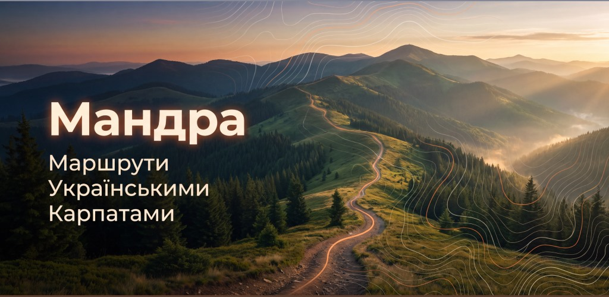
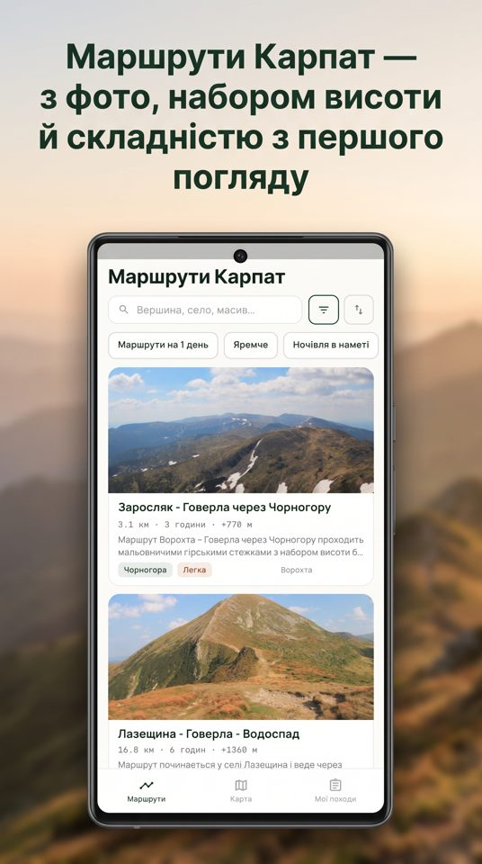
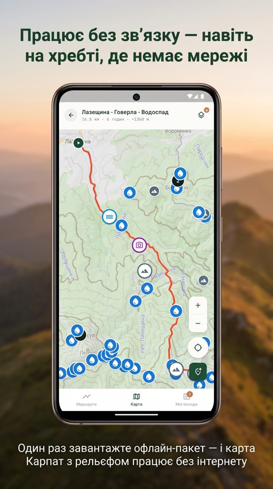
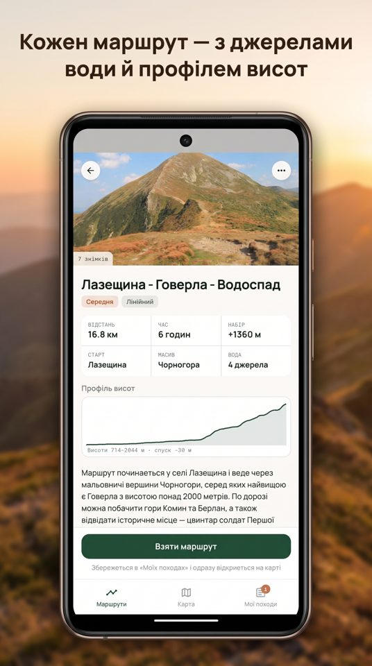
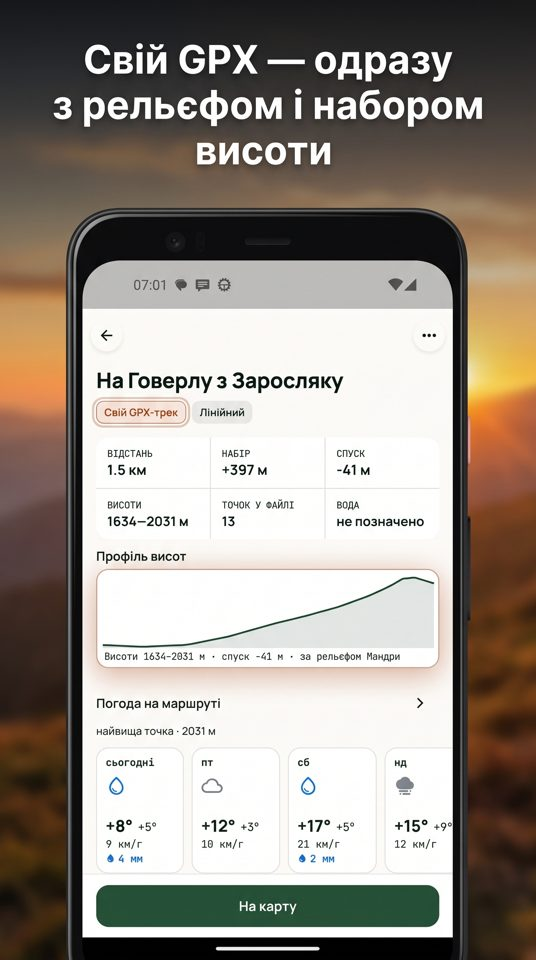
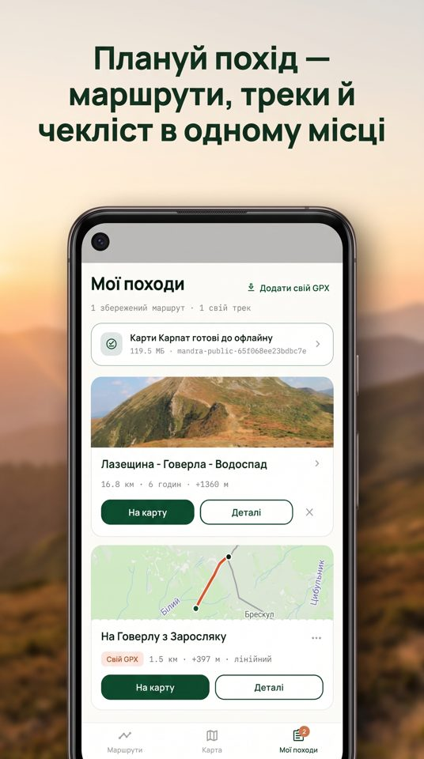

# Мандра — офлайн-карта Карпат для походів

**Мандра** — безкоштовний застосунок для піших походів Українськими Карпатами.
Маршрути з профілем висот, джерела води й стоянки, карта з рельєфом — і все це
працює там, де зв'язку вже немає.

- Сайт: **https://mandra.in.ua**
- Google Play: https://play.google.com/store/apps/details?id=com.mandra.carpathians&referrer=utm_source%3Dgithub%26utm_medium%3Dreadme

Без реклами, без підписки, без реєстрації. Android.

## Що вміє

- **106 маршрутів** Чорногорою, Ґорґанами, Свидовцем, Боржавою, Мармаросами,
  Бескидами й Покутсько-Буковинськими Карпатами — з довжиною, набором висоти,
  профілем, тривалістю й тим, як дістатися до старту.
- **727 джерел води й 615 стоянок** на карті та прямо на треку маршруту.
- **Офлайн-пакет**: один раз завантажили вдома — і карта з рельєфом, маршрути й
  точки працюють на хребті без мережі.
- **Свій GPX**: імпортуйте трек, і він ляже на карту з рельєфом; довжину й
  набір висоти пораховано за моделлю рельєфу, а не за висотами з файлу.
- **«Мої походи»**: збережені маршрути, нотатки, чекліст спорядження, GPX для
  інших навігаторів.
- **Позначки від людей**: джерело, стоянка чи притулок, яких немає на карті, —
  після перевірки з'являються в усіх.

| Каталог | Карта офлайн | Маршрут | Свій GPX | Мої походи |
|---|---|---|---|---|
|  |  |  |  |  |

## Маршрути на сайті

Кожен маршрут, вершина, озеро й село мають свою сторінку з картою, профілем і
GPX, наприклад:

- [Заросляк — Говерла](https://mandra.in.ua/marshruty/zarosliak-hoverla-chornohora/)
- [Вершини Карпат](https://mandra.in.ua/hory/)
- [Джерела води по хребтах](https://mandra.in.ua/dzherela/)
- [Села, з яких починаються маршрути](https://mandra.in.ua/sela/)

## Бракує маршруту або знайшли помилку?

Відкрийте [issue](../../issues/new/choose): «Додайте маршрут» або «Помилка на
карті». Можна й прямо із застосунку: «Ще» → «Написати нам».

## Про цей репозиторій

Це сторінка проєкту, а не його код: тут живуть опис, зворотний зв'язок і
запити на нові маршрути. Застосунок і сайт розробляються окремо.
